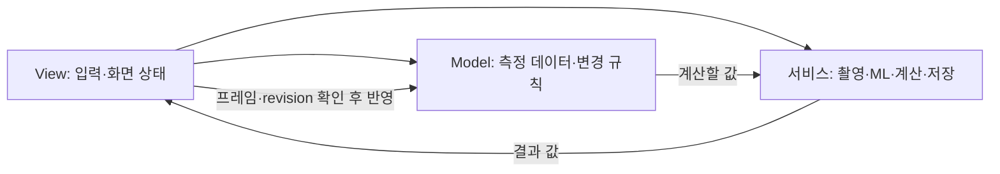

# LiDAR 모듈의 MV 구조

갱신: 2026-09-28 · 브랜치: `feat/3-LiDAR-Module`

팀의 MV(Model–View) 결정에 맞춰 **화면별 ViewModel을 두지 않는다.** View가 측정 Model을 소유하며, 카메라·계산·저장은 전용 서비스에 요청한다. 서비스는 ViewModel 계층이 아니라 화면과 독립적인 실행·입출력 담당이다.

## 책임 구분

| 구분 | 주요 타입 | 책임 |
| --- | --- | --- |
| Model | `ManualMeasurement`, `AutomaticMeasurement` | 측정 사진·깊이·점·정의·결과·수치형 줄자 기준값·촬영 조건, 데이터 변경 규칙 |
| Model의 공통 데이터 | `CaptureSnapshot`, `GarmentLandmarkSet`, `GarmentMeasurementResult`, `SavedMeasurement` | 카메라·ML·거리 엔진·저장이 주고받는 값 |
| View | `LiDARLabView`, `MeasurementDetailView`, `AutomaticMeasurementResultView` | 입력 문자열·선택한 점·화면 전환·오류 알림·로딩 표시·공유 URL·이미지 캐시 |
| 계산 서비스 | `LiDARMeasurementEngine`, `MeasurementPipeline` | 깊이 역투영·품질 검증·거리 계산, UI와 분리된 실행 |
| 자동 실행 서비스 | `AutomaticMeasurementWorkflow`, `RecordedMeasurementService` | 같은 프레임의 촬영→ML→계산, 취소·시간 제한·작업 상한·시도 기록 |
| 입출력 서비스 | `ARKitCaptureProvider`, `MeasurementArchive`, `MeasurementAttemptJournal` | 카메라 세션, 원본 캡처, 측정 저장, 성공·실패 기록 |
| 표시 보조 | `SnapshotPresentation` | 사진 방향·화면 비율·기기명 표시. Core에서 UIKit을 사용하지 않도록 분리 |

`Core/`의 Model과 서비스는 SwiftUI·UIKit·Combine을 가져오지 않는다. 순수 Swift Package 테스트에서 UI 없이 실행할 수 있다.

## 화면과 Model의 관계

수동 측정 화면은 `@State`로 `ManualMeasurement` 값 하나를 소유한다. 사용자가 항목·점·평면 보정 옵션을 바꾸면 Model이 계산 revision을 바꾸고 이전 결과를 무효화한다. View의 `.task(id:)`가 새 데이터로 계산하며, Model은 다른 revision·프레임·항목의 응답을 거절한다. 드래그 중 60ms 대기와 화면 종료 시 계산 취소는 View가 관리한다.

자동 결과 화면은 `@State`로 `AutomaticMeasurement`를 소유한다. 성공 항목과 실패 항목을 함께 유지하며, 같은 사진에서 사람이 다시 지정한 점으로 비교할 때 원본 프레임·옵션·측정점 출처를 보존한다. 텍스트 필드의 `"50.0"`은 View 상태이고, 저장될 `50.0cm` 값은 Model 데이터다. 잘못된 입력은 저장 전에 거절한다.

저장 중 입력을 수정하면 완료된 이전 저장의 공유 URL을 현재 화면 결과로 표시하지 않는다. 이미지 디코딩 결과도 View가 캐시하며 Model은 원본 촬영 데이터만 보유한다.

## 서비스와 카메라 연결

`RecordedMeasurementService`는 workflow와 journal을 주입받고 결과 값을 반환한다. 화면의 알림 문구·로딩 플래그·화면 전환용 세션을 보유하지 않는다. 같은 서비스와 workflow 인스턴스를 재촬영 간 유지해 취소를 무시하는 provider의 작업 상한도 유지한다.

카메라 어댑터의 `ObservableObject`는 AR 세션 상태 변경을 View에 알리는 수단이다. `ViewModel`로 화면 상태를 대신 관리한다는 의미는 아니다. 어댑터는 카메라 상태·깊이 여부·추적 상태를 게시하고, `LiDARCameraView`가 그 상태를 안내 문구로 바꾼다.

메이슨의 `CaptureSnapshotProviding`, 이치의 `GarmentLandmarkProviding` 계약은 그대로다. 실제 ML 주입 지점도 `LiDARLabView(landmarkProvider: modelAdapter)`를 유지한다. 센서 임계값·거리 공식·저장 스키마 버전은 이번 구조 변경으로 바꾸지 않았다.

## 이후 개발 규칙

- 새 화면에 별도 `SomeViewModel`을 추가하거나 UI 상태를 `SomeModel`이라는 이름으로 옮기지 않는다.
- 입력 문자열·포커스·시트·알림은 View에서 관리한다. 여러 View가 같은 화면 상태를 편집하면 필요한 `Binding`만 전달한다.
- 측정 데이터의 유효성·출처·변경 규칙은 Model에 두고 UI 없이 테스트한다.
- 센서·파일 입출력·비동기 계산은 서비스에 둔다. 무거운 계산을 View의 `body`에서 수행하지 않는다.
- 원본 촬영·계산 계약과 저장 호환성을 유지한다. MV 전환을 실제 정확도 개선이나 ML 연동 완료로 해석하지 않는다.

실행 방법은 [테스트 안내](LiDAR-Testing-Guide.md), 팀 연결은 [인수·연결 안내](LiDAR-Handoff.md), 실행한 검증과 한계는 [검증 기록](LiDAR-Validation.md)을 참고한다.
