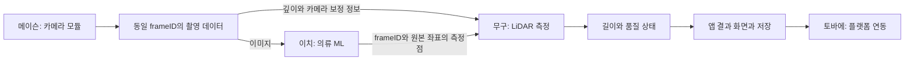

# LiDAR 측정 모듈 개발 로드맵

- 작성일: 2026-09-23
- 프로젝트: `2026-C6-Dobby`
- 작업 브랜치: `feat/3-LiDAR-Module`
- 담당: 무구
- 연동 담당: 카메라 입출력·제어 — 메이슨 / 의류 ML — 이치 / 판매 플랫폼 연동 — 토바에
- 문서 상태: 개발 제안. 아래 인터페이스·일정·정확도 수치는 구현 결과가 아니라 팀 합의 및 실물 검증 대상이다.
- 구현 현황: LiDAR 모듈과 직접 테스트 화면을 구현했다. 실제 사용은 [테스트 안내](LiDAR-Testing-Guide.md), 팀 연결은 [연동 문서](LiDAR-Integration.md), 검증 결과는 [검증 기록](LiDAR-Validation.md)을 참고한다. 아래의 “현재 출발점”은 구현 전 조사 시점의 상태다.

## 2026-09-25 진행 상태

- 기준 기기: iPhone 17 Pro. 사용자가 지금 실측하기 어렵다고 알려 실제 센서 기준선은 대기 중이다.
- 9/25 마감의 촬영·A/B 지정·줄자 비교·저장·재생 도구와 실측 비교 보고서/CSV를 구현했다. **실물 오차 기록이 없으므로 단계 2의 인수 기준은 아직 완료가 아니다.**
- 상의·아우터·바지·치마·원피스 프리셋과 자유 두 점 측정을 제공한다. 모든 의류 자동 인식이나 모든 소재의 정확도 검증을 완료한 것은 아니다.
- 깊이 코어 및 실시간 안내의 재현된 오류를 수정했다. 실측 없이 임계값을 바꾸거나 정확도 목표 달성을 선언하지 않는다.
- 실측 수집 순서는 [iPhone 17 Pro 실측 기준선 안내](LiDAR-Baseline-Protocol.md), 자동 검증 근거는 [검증 기록](LiDAR-Validation.md)을 따른다.

## 2026-09-27 진행 상태

- 9/27은 별도 마감일이 없고, 9/28의 **깊이 안정화·오차 비교**를 준비하는 날이다. 9/25까지 구현한 실측 수집 도구에 프레임 선택과 깊이 출처 비교를 추가했다.
- 촬영 요청 후 첫 사용 가능한 후보부터 0.35초 동안 깊이·신뢰도·카메라 움직임을 비교해 한 프레임을 선택한다. 이미지·깊이·보정값은 그 한 프레임에서 함께 보관한다.
- 기본 측정은 raw `sceneDepth`를 유지한다. 지원 기기에서는 같은 ARFrame의 `smoothedSceneDepth`도 함께 저장해 같은 점·설정으로 비교한다.
- 동일 촬영 쌍에서 양쪽 모두 수치가 나온 공통 표본으로 오차를 비교하고, 한쪽 실패와 깊이 비교 자료 누락은 별도로 집계한다. 이전 저장 파일도 계속 읽을 수 있다.
- ML 점의 부분 수동 수정에서 출처가 잘못 바뀌는 오류와 저장 실패가 실측 보고서에 포함되는 오류를 회귀 검증으로 수정했다.
- **실측 미제공으로 9/25 실기기 기준선과 9/28 개선안 채택 판정은 대기 상태다.** 9/29 실제 카메라·ML 통합도 메이슨·이치의 구현을 받아 검증해야 한다.

## 9/30 범위의 선행 구현 (2026-09-27)

사용자의 요청으로 9/29 자동 흐름과 9/30 평가·인수 도구까지 앞당겨 구현했다. 날짜를 7/30으로 적은 요청은 사용자가 **9/30 로드맵 전체 구현**으로 정정했다.

- 자동 workflow: 동일 프레임의 촬영→모델점→전체 치수, 부분 실패, 취소·재촬영·시간 제한, 오래된 결과 차단과 작업 수 상한.
- 직접 테스트 UI: 합성 자동 연결 테스트, 전체 항목 표시·저장·다시 열기, 같은 사진의 수동점 검증, 항목별 줄자값.
- 최종 평가 도구: 수동/모델점 분리, 조건별 오차·반복 편차, 같은 프레임의 자동−수동 비교, CSV·Markdown 내보내기.
- 시도 기록: 사진이 없는 촬영 실패도 기록하고, 수동 촬영과 자동 전체 흐름·합성 실행을 분리해 지연·실패·취소를 집계.
- **실제 카메라/ML 통합과 실물 인수는 완료가 아니다.** 팀 모듈·모델과 실측 자료가 필요하다. 연결 방법과 인수 조건은 [인수·연결 안내](LiDAR-Handoff.md)에 정리했다.

## 1. 목표와 현재 출발점

**동일한 순간에 촬영한 사진과 LiDAR 깊이 정보에, ML이 찾은 의류 측정점을 결합하여 실제 길이를 계산한다.**

LiDAR 모듈이 받는 것은 ‘어깨가 여기 있다’는 좌표이고, 돌려주는 것은 ‘이 두 점 사이가 몇 cm인가’라는 측정 결과다. 어깨·소매·밑단을 찾는 역할은 이치의 ML 모듈에, 카메라 세션과 촬영 화면은 메이슨의 모듈에 둔다.

현재 브랜치에는 SwiftUI 기본 화면만 있으며, 카메라·ML·LiDAR 모듈과 테스트 타깃은 아직 없다. 프로젝트는 iPhone·iPad를 대상으로 하고 배포 대상은 iOS 26.4, 기본 actor 격리는 MainActor로 설정되어 있다. 따라서 테스트 기기의 OS와 LiDAR 지원을 먼저 확인하고, 계산 작업을 UI 실행 흐름에서 분리해야 한다.

MVP는 펼쳐 놓은 긴팔 상의부터 시작한다. 초기 측정 항목은 가슴 단면·어깨너비·총장·소매길이를 제안하며, 각 항목의 시작점·끝점과 직선/꺾인 경로 여부를 이치와 먼저 합의한다. 특히 래글런·드롭숄더처럼 어깨 기준이 다른 옷은 일반 상의와 같은 기준을 억지로 적용하지 않는다.

LiDAR 미지원 기기의 실제 길이 측정은 이번 범위에서 제외한다. 향후 높이 입력 또는 기준 물체 방식이 들어올 수 있도록 결과 형식에 측정 출처를 남긴다.

## 2. 팀 간 책임과 연결 구조

| 담당 | 책임 | 다른 모듈에 전달할 것 |
|---|---|---|
| 메이슨 | 권한, 카메라/AR 세션, 프리뷰, 촬영, 방향·화각, 프레임 보관과 전달 | 같은 프레임의 이미지·깊이·보정 정보 묶음 |
| 이치 | 의류 종류 판별, 측정점 검출, ML 입력 전처리·출력 좌표 복원 | 원본 이미지 좌표의 측정점·가림 상태·모델 점수, 가능하면 의류 마스크 |
| 무구 | 깊이 품질 판정, 좌표 정합 검증, 3D 역투영, 길이 계산, 실측 정확도 검증 | 항목별 길이·측정 상태·계산 방법·실패 사유 |
| 앱 통합 담당 | 같은 프레임으로 ML과 측정을 순서대로 호출, 결과 표시·저장 | 재현 가능한 측정 기록 |
| 토바에 | 판매 플랫폼에 상품과 치수 전달 | 저장된 측정 결과 사용; 센서 데이터에 직접 의존하지 않음 |

앱 통합 담당자는 별도 합의한다. 무구는 연결에 필요한 인터페이스와 테스트용 연결 코드를 제공한다.



카메라 세션의 최종 소유자는 메이슨 쪽 하나로 둔다. 무구가 센서 실험용 화면을 먼저 만들더라도, 그 코드는 나중에 공통 캡처 모듈로 교체되는 임시 어댑터여야 한다. 두 모듈이 각각 카메라 세션을 시작하는 구조는 피한다.

## 3. 가장 먼저 합의할 데이터 계약

타입 이름은 제안이다. 공통 타입을 먼저 작은 PR로 공유하면 각자 실제 구현을 기다리지 않고 개발할 수 있다.

### 3.1 메이슨 → 무구·이치: `CaptureSnapshot`

| 필드 | 의미와 규칙 |
|---|---|
| `sessionID`, `frameID`, `timestamp` | 세션 재시작과 프레임을 식별. ML 결과와 깊이를 결합하는 기준 |
| `image`, `imageSize` | 원본 이미지 버퍼와 실제 픽셀 크기 |
| `depthMap`, `depthSize` | 이미지와 정합된 깊이맵, 단위 m. MVP 계약은 광축 방향 깊이로 통일 |
| `confidenceMap` | 있으면 깊이 신뢰도 등급. 없으면 ‘알 수 없음’; 높은 신뢰도로 채우지 않음 |
| `intrinsics`, `intrinsicsReferenceSize` | 렌즈의 투영 특성과 이 값이 유효한 이미지 해상도 |
| `imageToDepthMapping` | 이미지 위치를 깊이맵 위치로 변환하는 규칙. 동일 화각·정합이 확인된 경우에만 크기 비율로 변환 |
| `orientation`, `imageToViewTransform` | 원본을 프리뷰에 표시할 때 적용한 회전·크롭·미러링 정보 |
| `depthSource`, `calibrationStatus` | ARKit sceneDepth / smoothedSceneDepth / AVFoundation 등의 출처와 보정 상태 |
| `cameraTransform`, `trackingState` | 여러 프레임을 결합할 때 필요한 카메라 자세와 추적 상태. 단일 프레임 거리 계산에서는 자세가 필수는 아님 |

버퍼의 소유권과 유효 기간도 계약에 포함한다. ML 처리 동안 원본 스냅샷을 유지하고, 완료·취소 시 해제한다. 프레임을 무제한 쌓지 않으며, 만료된 프레임의 ML 결과에 최신 깊이를 대신 연결하지 않는다.

### 3.2 이치 → 무구: `GarmentLandmarkSet`

- `sessionID`, `frameID`: 실제 추론에 사용한 촬영 프레임.
- `garmentID`, `category`, `modelVersion`, `landmarkSchemaVersion`: 한 화면의 여러 옷과 모델 변경을 구분.
- 각 점: 의미를 나타내는 ID, `x/y`, 모델 점수, 보임/가림/미검출 상태.
- 권장 공통 좌표: **크롭·회전하지 않은 원본 이미지의 왼쪽 위를 원점으로 하고, 오른쪽이 +x, 아래가 +y인 0~1 정규화 좌표**. 픽셀 중심 변환과 경계 처리 규칙도 함께 정한다.
- 모델 입력의 리사이즈·패딩·크롭·회전은 이치의 어댑터가 역변환하여 반환한다. Vision 결과의 원점 방향도 이 단계에서 통일한다.
- 좌우는 ‘착용자 기준’ 등 하나로 정의하고 ID에 반영한다. 화면 좌우와 혼용하지 않는다.
- 의류 마스크는 선택 필드로 시작하되, 옷 가장자리의 깊이 오염을 줄이는 개선 단계에서 제공을 권장한다. 마스크도 원본 이미지와의 변환을 포함한다.

### 3.3 무구 → 앱: `GarmentMeasurementResult`

- 세션·프레임·옷 ID, 측정 시각, 항목별 길이. 내부 단위는 m, 표시할 때 cm로 변환.
- 사용한 측정점 ID와 좌표, 알고리즘 버전, 측정 정의 버전, 센서 출처.
- 항목별 상태: `valid`, `uncertain`, `unavailable`.
- 품질 근거: 유효 깊이 표본 수, 깊이 분산, ML 점수, 평면 잔차 등. 센서 신뢰도 등급과 ML 점수를 ‘cm 정확도’로 해석하지 않는다.
- 계산 방법: 직접 역투영한 두 점의 직선 거리 / 검증된 평면 보정 / 명시된 다점 경로 등.
- 실패 사유: `unsupportedDevice`, `frameMismatch`, `invalidCalibration`, `missingLandmark`, `insufficientDepth`, `outOfBounds` 등.

숫자 0으로 실패를 표현하지 않는다. 가슴만 유효하고 소매가 미검출이면 가슴 결과를 유지하고 소매 상태를 별도로 반환한다. 값이 충분히 신뢰되지 않으면 확정 치수로 저장하지 않도록 앱과 연결한다.

## 4. 단계별 개발 로드맵

기간은 무구의 집중 개발 기준 제안이며, 실기기 확보와 팀 연동 일정에 따라 조정한다. 전체 2주 안팎을 첫 계획으로 잡되, 센서 정확도 목표 달성은 실측 결과로 판단한다.

| 단계 | 예상 기간 | 무구의 작업 | 팀 연동·완료 기준 |
|---|---|---|---|
| 0. 계약과 측정 기준 | 0.5~1일 | 공통 타입, 좌표·단위, 항목별 정의, 실패 상태, 샘플 데이터 확정 | 메이슨·이치가 같은 샘플을 해석하고 프레임 불일치를 거부 |
| 1. 순수 거리 계산 | 1~2일 | 깊이 버퍼 해석, 이미지→깊이 매핑, 역투영, 두 점 거리, 입력 검증 | 알려진 정답의 평면·기울어진 평면 및 회전/크롭 테스트 통과 |
| 2. 실기기 기준선 | 1~2일 | 테스트 캡처 어댑터, 깊이·측정점 디버그 화면, 스냅샷 저장·재생 | 수동으로 지정한 정답점으로 센서·기하 오차를 먼저 측정 |
| 3. 깊이 안정화 | 2~3일 | 경계 보존 표본 선택, 이상치 제거, 조건부 국소 평면 보정, 프레임 품질 선택 | 같은 실측 세트에서 기본 알고리즘 대비 오차·거부율 비교 |
| 4. ML·카메라 통합 | 1~2일 | 테스트 대역을 실제 모듈로 교체, 동일 프레임 매칭, 부분 실패 처리, 비동기 계산 | 한 번 촬영하면 점과 치수가 자동 표시되고 오래된 결과가 덮어쓰지 않음 |
| 5. 실측 검증·인수 | 1~2일 | 거리·각도·소재별 평가, 성능 측정, 재현 자료와 문서 정리 | 정확도·성공률·시간을 함께 보고하고 사용 가능 조건 확정 |

### 단계 0 — 구현 전에 기준 고정

메이슨과는 MVP 입력 경로를 우선 결정한다. **ARKit의 동일한 `ARFrame`에서 `capturedImage`, `sceneDepth`, 카메라 정보를 얻는 구성을 기준선으로 제안한다.** ARKit은 이미지에 대응하는 깊이와 신뢰도 지도를 제공한다. 지원 여부는 기기명 목록보다 `supportsFrameSemantics(.sceneDepth)`로 검사한다. [Apple ARDepthData](https://developer.apple.com/documentation/arkit/ardepthdata), [Apple sceneDepth](https://developer.apple.com/documentation/arkit/arframe/scenedepth)

메이슨이 AVFoundation을 선택한다면 동기화된 영상·미터 단위 깊이·보정 정보를 동일 계약으로 변환하는 어댑터가 필요하다. `AVDepthData`와 ARKit 깊이의 좌표·왜곡·신뢰도 특성을 같다고 가정하지 않는다. 이 선택은 캡처 어댑터에서 흡수하고 거리 계산 엔진의 입력은 통일한다. [Apple LiDAR 캡처 예제](https://developer.apple.com/documentation/avfoundation/capturing-depth-using-the-lidar-camera)

이치와는 긴팔 상의 그림 위에 측정점 이름과 연결선을 먼저 표시한다. 예를 들어 ‘총장’의 시작점이 목 옆인지 등 중심인지 정하지 않으면, 계산이 맞아도 줄자 기준과 다른 값이 나온다. 소매도 어깨~소매 끝 직선인지 팔꿈치를 경유하는 길이인지 명시한다. 두 점의 중점을 사용하는 항목은 이미지상 중점인지 실제 3D 중점인지 정한다. 기울어진 촬영에서는 두 중점이 일치하지 않을 수 있다. 이 단계의 정답 좌표 샘플을 ML 테스트 대역으로 사용한다.

### 단계 1 — 역투영 기반 계산 코어

계산 흐름은 다음과 같다.

1. ML 측정점이 해당 프레임 원본 이미지의 어느 위치인지 확인한다.
2. 그 위치에 대응하는 유효 깊이 `z`를 읽는다.
3. 카메라 보정 정보로 사진의 점을 실제 공간의 `X, Y, Z` 좌표로 복원한다. 이것이 역투영이다.
4. 두 3D 점 사이의 직선 길이를 구한다.

```text
X = (u - cx) × z / fx
Y = (v - cy) × z / fy
Z = z

길이(m) = sqrt((X2-X1)² + (Y2-Y1)² + (Z2-Z1)²)
```

`u, v`는 보정된 이미지의 점, `fx, fy, cx, cy`는 해당 이미지 좌표에 맞는 카메라 내부 파라미터다. 이미지 크기를 바꾸면 내부 파라미터도 맞춰야 한다. 위 식은 +x 오른쪽, +y 아래, +z 전방인 계산용 좌표계이며, ARKit 월드 좌표와 결합할 때는 축 변환을 명시한다.

Apple의 깊이는 **카메라 평면 기준 깊이**이므로, 단위 길이로 정규화한 광선에 그대로 곱하는 방법과 구분한다. 카메라나 옷이 놓인 평면이 기울어져도 각 점의 깊이를 따로 쓰므로 동일한 3D 거리 공식으로 처리할 수 있다. [Apple 깊이 데이터 설명](https://developer.apple.com/documentation/arkit/ardepthdata)

초기 코어에는 평면 검출·AR 앵커·전체 3D 메시 생성이 필수적이지 않다. 먼저 두 점의 올바른 복원에 집중한다. 이미지와 깊이 버퍼의 행 간격, 비정상 값, 0·결손 깊이, 범위 밖 좌표, 잘못된 보정 정보를 검증한다.

### 단계 2 — ML과 독립적인 실제 센서 검증

테스트 화면에서만 사람이 점 두 개를 찍어 길이를 확인할 수 있게 한다. 최종 사용자 흐름은 자동 측정으로 유지한다. 이 임시 화면의 목적은 ML 위치 오차를 제거하고 LiDAR 계산만 검증하는 것이다.

- 길이를 아는 평평한 물체와 줄자로 확인한 의류를 촬영한다.
- RGB·깊이·신뢰도·카메라 파라미터·방향·프레임 ID·정답점을 함께 저장한다.
- 저장한 스냅샷을 재생하여 같은 장면에서 알고리즘을 반복 비교한다.
- 가로·세로·상하 반전, iPhone·iPad 화면 비율, aspect-fill 크롭을 확인한다.
- 프리뷰상의 점을 원본 좌표로 되돌린 결과와 원본에서 직접 선택한 결과가 일치하는지 검사한다.

### 단계 3 — 가장자리와 깊이 잡음 개선

초기 기준선은 단일 프레임 측정이다. 개선안은 하나씩 추가하고 같은 데이터에서 비교한다.

- **표본 필터:** 센서 신뢰도, 거리 유효성, 주변 깊이의 일관성으로 이상치를 제거한다.
- **경계 보존:** 가장자리 주변을 무조건 평균 내지 않는다. 가능하면 의류 마스크 안쪽의 표본을 선택해 바닥 깊이가 섞이는 것을 줄인다.
- **기울기 보존:** 기울어진 평면에서 넓은 영역의 깊이를 동일 값으로 대체하지 않는다. 유효한 근처 3D 표본으로 국소 평면을 추정하고, 평면에 잘 맞을 때만 원래 측정점의 광선과 교차시켜 깊이를 보완하는 방식을 실험한다.
- **촬영 품질 판정:** 화면 전체의 깊이 차이가 크다는 이유만으로 재촬영을 요구하지 않는다. 기울어진 평면에서도 깊이 차이는 정상적으로 발생하므로, 평면에서 벗어난 정도와 실제 결손·흔들림을 구분한다.
- **끝점 유지:** 안정적인 깊이를 얻으려고 측정점을 옷 안쪽으로 이동시키면 길이가 짧아진다. 깊이 표본 영역과 실제 끝점 위치를 구분한다.
- **필터 비교:** `sceneDepth`와 시간적으로 평활화한 `smoothedSceneDepth`를 같은 실측 조건에서 비교한다. 후자가 더 매끄럽다는 이유만으로 더 정확하다고 판단하지 않는다. [Apple smoothedSceneDepth](https://developer.apple.com/documentation/arkit/arframe/smoothedscenedepth)
- **프레임 선택:** 짧은 후보 구간에서 흔들림·유효 깊이를 보고 프레임을 고른 뒤 그 프레임의 이미지로 ML을 실행한다. 다른 프레임의 점과 깊이를 섞지 않는다.

여러 프레임을 융합하는 고도화는 자세·장면 정합을 검증한 뒤 수행한다. 같은 픽셀의 깊이를 시간순으로 단순 평균하면 카메라 움직임 때문에 서로 다른 위치가 섞일 수 있다.

평면 보정이 주름진 옷을 억지로 평평하게 만들지 않도록 평면 적합 여부를 검사한다. 주름·접힘이 있는 옷의 ‘펴졌을 때 길이’는 두 점의 직선 거리와 다르다. 원래 판매 치수의 기준에 맞춰 옷을 펼쳐 촬영하고, 표면 길이 추정은 별도 검증 항목으로 둔다. 깊이 잡음을 촘촘히 이어 붙이는 표면 길이는 과대 측정될 수 있어 MVP 기본값으로 사용하지 않는다.

### 단계 4 — 자동 측정 통합과 성능

```text
촬영 데이터 고정
→ 그 이미지에서 ML 추론
→ 원본 좌표로 복원된 측정점 수신
→ 같은 frameID의 깊이로 계산
→ 항목별 결과 표시·저장
```

- ML 모듈이 준비되기 전에는 정답 좌표를 반환하는 테스트 대역으로 연결한다.
- 캡처 모듈이 준비되기 전에는 저장된 스냅샷을 반환하는 테스트 대역으로 연결한다.
- 캡처 이후 ML 응답이 늦어도 고정된 원본 스냅샷을 사용한다. 새 촬영이 시작되면 이전 작업을 취소하거나 결과를 구분한다.
- 계산은 전용 실행 흐름으로 분리하고, 화면 갱신만 MainActor로 전달한다. 현재 프로젝트의 MainActor 기본 설정에서 실제 실행 위치를 점검한다.
- 매 프리뷰 프레임마다 전체 이미지를 복사하거나 ML·거리 계산을 전부 실행하지 않는다. 프리뷰 갱신과 확정 측정의 주기를 분리한다.
- 성공한 치수는 유지하면서 실패 항목만 사유를 보여준다. 깊이 결손과 ML 미검출을 같은 ‘재촬영 필요’로 뭉뚱그리지 않는다.
- 저장 스키마에는 치수뿐 아니라 점 좌표·방법·품질 근거·알고리즘 버전을 포함해 나중에 재계산할 수 있게 한다. 전체 디버그 원본 보관은 개발용 옵션으로 두고 용량 상한을 정한다.

### 단계 5 — 실측 기준으로 완료 판정

센서·기하 성능과 자동 측정 성능을 나누어 기록한다.

| 평가 | 측정점 입력 | 확인할 문제 |
|---|---|---|
| A. 거리 엔진 평가 | 사람이 확인한 정답점 | 깊이 잡음, 보정, 좌표 변환, 거리 계산 |
| B. 전체 자동 측정 평가 | ML이 찾은 점 | 위 항목에 측정점 위치·종류 판단 오차가 추가된 결과 |

같은 이미지에서 A와 B를 비교하되, 오차가 단순히 더해진다고 가정하지 않는다. 두 평가가 있어야 ‘센서 계산을 고칠지, ML을 고칠지’를 결정할 수 있다.

초기 평가 세트는 긴팔 상의 10벌 이상, 가까움·중간·멀리의 3가지 촬영 거리, 정면·약한 기울기·큰 기울기의 3조건, 조건별 3회 반복으로 제안한다. 예비 범위는 0.6/0.9/1.2m 및 0/15/30도이며, 이는 지원 보장이 아니라 지원 범위를 알아내기 위한 시험 조건이다. 옷 전체가 들어오는 조건만 유효 비교에 사용하고, 잘린 경우도 실패율에 기록한다.

줄자 정답도 같은 측정 정의와 옷 펼침 상태로 2명 이상 확인한다. 어두운 옷·두꺼운 니트·반사 소재·배경과 색이 비슷한 옷을 포함한다. 최종 평가 옷은 알고리즘 조정용과 분리한다.

보고할 지표:

- 항목별 절대오차 평균(MAE), 오차의 95백분위(P95), 평균 부호 오차(계속 길거나 짧게 나오는 편향).
- 반복 측정의 흔들림, 유효 결과 비율, 재촬영률, 항목별 실패 사유.
- 촬영 확정→결과 표시 시간, ML을 제외한 거리 계산 시간, 메모리 사용·발열·프리뷰 끊김.
- 기기·거리·각도·소재별 결과. 실패 데이터를 버리고 성공 사례만으로 정확도를 발표하지 않는다.

초기 **검증 목표 제안**은 지원 조건에서 전체 자동 측정 MAE 1cm 이하·P95 2cm 이하·유효 결과 비율 90% 이상이다. 센서 정답점 평가도 별도로 보고한다. 이 수치는 현재 달성된 성능이나 LiDAR 하드웨어 보장이 아니다. 실기기 기준선이 목표에 못 미치면 허용 촬영 범위·지원 항목·출시 기준을 팀이 재조정한다.

## 5. 초광각 연동은 별도 검증 단계로 유지

이전에 논의한 ‘기본 화각으로 촬영하고 초광각으로 측정점을 찾는 방식’은 향후 확장 항목으로 유지한다. 다만 **초기 정확도 기준선은 깊이와 정합된 같은 카메라 이미지에서 측정점을 찾는 구성**으로 잡는다.

Apple 설명상 AVFoundation의 LiDAR Depth Camera는 광각 영상에 대응하는 깊이를 제공하며, 초광각은 멀티캠 세션에 별도로 추가할 수 있다. 초광각의 픽셀은 광각의 동일 픽셀과 같은 공간을 보지 않는다. [Apple WWDC22: LiDAR depth와 MultiCam](https://developer.apple.com/videos/play/wwdc2022/110429/)

초광각 측정점을 실제 길이 계산에 쓰려면 다음을 별도로 통과해야 한다.

1. 대상 기기에서 광각·초광각·LiDAR를 원하는 구성으로 얻을 수 있는지 확인.
2. 촬영 시각, 각 렌즈의 내부 파라미터·왜곡, 카메라 사이 위치 관계 또는 검증된 정합 방법 확보.
3. 초광각 좌표를 깊이 기준 이미지에 재투영하고 가려짐·겹치는 화각 확인.
4. 광각과 LiDAR 범위 밖의 점은 측정 불가로 처리.
5. 기본 구성과 동일한 실측 세트에서 정확도와 부하를 비교해 채택 여부 결정.

단순 배율 변환은 사용하지 않는다. 초광각을 구도 안내용으로 먼저 활용하는 것은 별도의 선택지다.

## 6. 기존 GarmentScan에서 참고할 부분

기존 프로젝트는 같은 Challenge 6 폴더의 `GarmentScan`에 있다. 새 앱에 전체를 복사하기보다 필요한 원리를 검증하면서 옮긴다.

| 기존 파일 | 재사용 후보 | 새 모듈에서 보완할 점 |
|---|---|---|
| `Capture/CaptureGeometry.swift` | CameraModel과 unprojection 개념 | 좌표·해상도·보정·축 규약을 새 계약으로 통일 |
| `Measure/GeometryFormulas.swift` | 3D 두 점 거리, 광축 깊이와 광선 거리의 구별 | 잘못된 보정·비정상 값 입력을 명시적으로 거부 |
| `Capture/DepthFrame.swift` | 깊이 버퍼 추출, 주변 표본 선택 | 신뢰도 누락을 높음으로 취급하지 않고 경계·기울기 보존 |
| `Measure/MeasurementEngine.swift` | 항목별 계산과 결과 모델의 개념 | 표면 경로 기본 사용과 직선 대체 정책 재설계 |
| `Detection/SizingPointDetector.swift` | 검출기를 교체하는 인터페이스 | 전체 촬영 모델 의존을 줄이고 frameID·좌표 계약 추가 |

`ARDepthCaptureController`는 카메라 제어·멀티캠·화면 상태·검출이 결합되어 있으므로 그대로 이식하지 않는다. 메이슨의 책임 경계에 맞는 어댑터만 설계한다. 기존 합성 테스트 수치를 실제 기기 정확도의 근거로 삼지 않는다.

## 7. 브랜치의 작업 단위와 인수 체크리스트

`feat/3-LiDAR-Module`에서 다음 순서로 작은 변경을 쌓는 것을 제안한다. 실제 PR 생성·병합은 이번 로드맵 작성에 포함하지 않았다.

1. `MeasurementContracts`: 공통 입력·출력, 좌표 규약, 측정점 사전, 샘플 fixture.
2. `LiDARGeometry`: 깊이 해석·역투영·두 점 거리와 계산 테스트.
3. `LiDARDebug`: 실기기 테스트 어댑터, 스냅샷 저장·재생, 디버그 오버레이.
4. `LiDARQuality`: 경계 표본 선택, 품질 판정, 선택적 평면 보정 및 비교 결과.
5. `MeasurementIntegration`: 카메라·ML 연결, 취소·부분 실패·결과 저장.
6. `LiDARValidation`: 실측 보고서, 지원 조건, 팀 인수 문서.

공통 계약은 팀의 통합 브랜치에 먼저 공유하고, 카메라·ML 작업이 이를 기준으로 병행되도록 한다. 공통 파일의 변경 책임자와 스키마 버전 정책을 정해 브랜치마다 타입이 달라지는 것을 막는다.

- [ ] 메이슨이 같은 프레임의 이미지·깊이·보정 정보를 전달한다.
- [ ] 이치가 그 이미지 기준의 점·가림 상태·모델 버전을 반환한다.
- [x] frameID, 좌표계, 미터 단위를 코드와 fixture로 검증한다.
- [x] 수평·기울어진 평면을 동일한 역투영 방식으로 계산한다.
- [x] 미지원 기기·깊이 결손·프레임 불일치를 정상 결과와 구분한다.
- [x] 부분 측정 성공을 보존하고 실패 원인을 설명한다.
- [ ] ML 없이 거리 엔진을, 실제 ML을 붙여 전체 흐름을 각각 평가한다.
- [ ] 실측 오차와 거부율·성능을 함께 기록한다.
- [x] 저장 스냅샷으로 팀원이 같은 결과를 재현할 수 있다.

첫 착수 산출물은 **공통 타입·측정점 사전·동일 프레임 샘플 한 세트·역투영 테스트**다. 이 네 가지를 먼저 공유하면 카메라와 ML이 완성되기 전에도 무구의 거리 계산 모듈을 독립적으로 개발할 수 있다.
