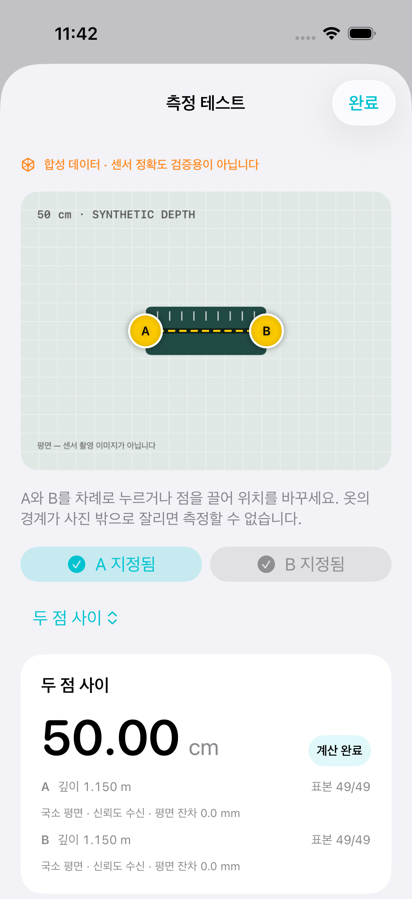
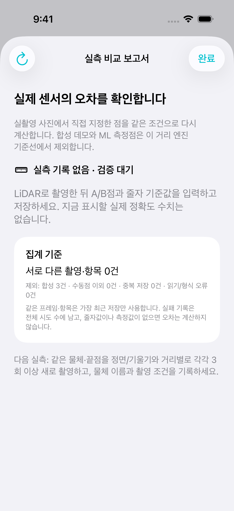
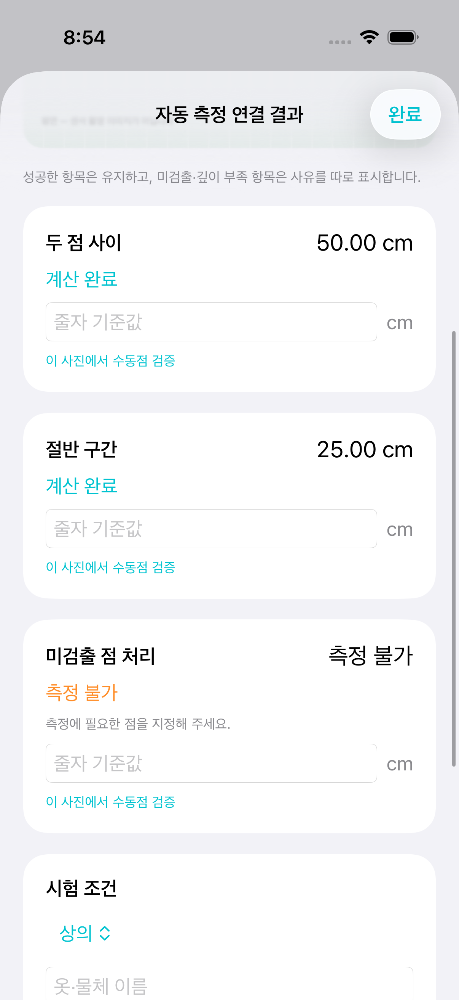

# LiDAR 구현 검증 기록

검증일: 2026-09-27 (9/23·9/25 기록 포함) / 브랜치: `feat/3-LiDAR-Module` / Xcode 27.0

| 검증 | 결과 |
|---|---|
| 독립 계산·좌표·품질·잘못된 입력 테스트 | 통과 |
| 저장·복원·옵션·줄자값·실패 상태 보존, ML 프레임 계약 | 통과 |
| Swift Package 테스트 합계 | 170개, 실패 0 (계산 33·저장/연동 13·실시간 상태 19·만료 8·의류 항목 6·기준선 보고서 18·프레임 선택 16·수동점 확인 7·자동 흐름 18·시도 기록 14·최종 보고서 18) |
| iPhone 17 Pro / iOS 26.4 화면 테스트 | 7개 통과: 기존 5개 + 자동 연결의 부분 성공·저장·복원 + 최종 보고서에서 합성 실행 제외 |
| iPad Pro 13-inch M5 / iPadOS 26.4 화면 테스트 | 같은 7개 흐름 통과 |
| 최종 옵션 복원 변경 후 저장·열기 회귀 검사 | 통과 |
| 원래 Dobby Xcode 프로젝트 시뮬레이터 빌드 | 성공 |
| 원래 Dobby Xcode 프로젝트 실제 기기용 빌드 | 성공 |
| 기본 모듈의 개발 인증서 서명 빌드 | 이전 구현에서 성공; 실시간 안내 변경은 서명 제외 기기용 빌드로 검증 |
| 실제 기기에 설치 | 사용자가 나중에 직접 설치하기로 함 |
| 실제 LiDAR 촬영 및 의류 cm 오차 | 아직 검증하지 않음 |

합성 데이터 테스트에는 두 점의 깊이가 서로 다른 경우, 25도 기울어진 평면, 화면 중심에서 떨어진 점, 신뢰도 누락·잘못된 값, 배경 마스크, 잡음·이상치, 부분 성공, 네 방향 좌표 왕복이 포함된다.

확인한 오류 수정:

- 촬영 화면이 닫힌 다음 결과 화면을 표시하도록 전환 순서를 고정했다.
- 원본 JPEG는 측정 화면을 만들 때 한 번 해독하여 점 이동 중 반복 해독을 없앴다.
- 계산 옵션 전체를 저장·복원한다.
- 저장 대기 중 점 또는 줄자 기준값을 바꿨다면 이전 기록의 공유 URL이 현재 결과로 나타나지 않는다.
- 불러온 측정점은 정의된 ID 순서로 A/B에 연결한다.
- 오래된 비동기 계산 결과는 현재 점 위치의 결과를 덮어쓰지 않는다.

실제 기기에서 추가 확인할 항목:

1. 카메라 권한 허용/거부, 잠금·백그라운드·복귀, 촬영 중 취소.
2. 네 방향 촬영에서 사진과 A/B 표시 위치 일치.
3. 동일한 줄자 기준점으로 거리·각도·소재별 오차와 반복 흔들림.
4. 카메라·실제 의류 ML 모듈 연결 후 프레임·좌표 계약과 전체 자동 측정 오차.

테스트 실행 명령은 README에 있다. Xcode UI 테스트 산출물은 실행마다 `/tmp/dobby-lidar-ui.*` 아래에 만들어진다.

## 실시간 촬영 안내 추가 검증

- Core 상태 테스트 19개: 후보 없음·다중 후보·가장자리 잘림·크기 부족·깊이 결손·신뢰도 미상·경계 깊이 부족·시간 안정성·순서 역전·오래된 관측·잘못된 마스크·기울어진 깊이 표면.
- iPhone 17 Pro·iPad Pro 13-inch M5 시뮬레이터에서 정상 깊이 → 깊이 없음 → 움직임 → 여러 대상 안내 전환 통과. iPad에서는 기존 측정·저장·깊이 결손 흐름을 포함한 3개 화면 테스트 모두 통과.
- 최종 소스의 원래 Xcode 프로젝트 기기용 빌드 성공(서명 제외). Swift 소스 경고 없음.
- Vision과 깊이 평가는 분석 큐에서 한 번에 한 작업만 수행. 최대 512px 영상, 최소 분석 간격 0.6초.
- 원본 프레임의 나이와 카메라 업데이트 중단을 모두 확인해 오래된 초록 표시를 제거한다. ARKit 정상 추적 중의 움직임도 별도로 감지한다.
- 이 화면 테스트는 합성 마스크·깊이를 사용한다. 실제 Vision의 옷 후보 검출률, 실제 센서 깊이 품질, 실기기 지연·발열·배터리 및 회전 후 테두리 정합은 기기에서 추가 확인해야 한다.

## 2026-09-25 기준선 준비·회귀 개선

대상 실기기는 사용자가 지정한 iPhone 17 Pro다. 현재 실측이 어려워 **실물 정확도는 검증 대기**로 유지한다. 자동 검증을 늘렸지만 오늘 일정의 실기기 오차 기록 완료로 처리하지 않는다.

### 재현한 오류 수정

- 의류 마스크가 제외한 점을 주변 표면으로 보간하더라도 정상 품질로 표시하지 않고 확인 필요로 남긴다.
- 양수라도 잘못된 초점거리 때문에 비유한 3D 좌표가 만들어지는 보정 입력을 거부한다. 결과 JSON 저장에 무한대가 들어가는 것을 차단했다.
- 거리 계산에 `hypot`을 사용해 직접 제곱할 때 생기는 수치 언더플로를 피한다. 알고리즘은 `lidar-unprojection-1.0.1`이다.
- 카메라 프레임이 멈춘 뒤 늦게 도착한 결과, 만료 직전에 UI로 넘어온 결과가 초록 표시를 되살리지 못하게 한다. 원본 프레임 나이와 단조 시계 기준 도착 시간을 함께 검증한다.
- 손상된 요약 파일 하나가 정상 보관함 전체를 숨기지 않게 한다. 기준선 보고서는 읽지 못한 기록 수도 표시한다.
- 측정 항목을 바꾸면 이전 줄자값과 측정점을 초기화한다. 잘못 입력한 줄자값을 누락값으로 조용히 저장하지 않는다.

### 추가 검증

- 비대칭 초점거리·주점, 양축 기울기, 깊이 해상도 160/256/320을 조합한 독립 기하 검증 45조건을 포함한다. 이는 XCTest 1개 안의 조건 반복이며 별도 45개 테스트로 중복 집계하지 않는다.
- 6개 의류 카테고리의 각 측정 정의가 실제 엔진에서 작동하는지 확인한다. 자동 인식 검출률 테스트는 아니다.
- 실측 집계에서 합성·모델점 제외, 중복 촬영 방지, 실패 분모 유지, 기준값 누락, 오차 부호·P95, 과거 스키마 호환, CSV를 검증한다.
- iPhone·iPad의 보고서 빈 상태 및 바지 프리셋 선택 시 이전 점·줄자값이 초기화되는 화면 흐름을 검증한다.
- iPad 화면 테스트의 큰 스크롤이 선택 메뉴를 내비게이션 바 뒤로 넘기던 문제를 작은 방향성 스크롤로 수정했다. 테스트 프로젝트의 iPad 회전 설정도 실제 앱과 일치시켰다.

### 실측 시 사용할 기능

[실측 기준선 안내](LiDAR-Baseline-Protocol.md)에 따라 새 사진·점·줄자값·옷 이름·촬영 조건을 저장하고, 홈의 실측 비교 보고서와 CSV를 사용한다. 기존 버전 1 기록은 추가 테스트 조건이 없어도 열린다.

### 후속 검증

9월 30일 최종 마감까지 4시간 간격으로 이 대화에서 변경 여부를 확인하는 자동화를 등록했다. 새 코드·사용자 제공 실측 자료 또는 새 실패가 있을 때 관련 테스트와 필요한 수정만 진행한다. 변화가 없으면 같은 테스트와 사용자 알림을 반복하지 않는다. 사용자 설치·실측 보류, 팀 변경 보존, 실제 정확도 미확인 상태를 계속 존중한다.

검증한 코드 목록과 SHA-256은 [검증 상태 파일](LiDAR-Verification-State.json)에 남긴다. 이후 자동화는 이 상태와 비교해 변경 여부를 판단할 수 있다.

## 2026-09-27 깊이 안정화 준비

### 추가 구현

- 첫 사용 가능한 후보부터 0.35초 동안 깊이 유효 비율·높은 신뢰도 비율·움직임을 비교해 하나의 프레임을 선택한다. 기본 측정은 raw sceneDepth를 사용한다.
- 지원 시 선택된 동일 ARFrame의 smoothedSceneDepth를 함께 복사한다. 후보 RGB 복사본은 최선 1개로 제한하고 최종 JPEG는 1회 생성한다.
- 후보 수·선택 대기시간·품질 근거·정책 버전을 저장하고 결과 화면에서 펼쳐 확인할 수 있다. 선택 대기시간은 최종 JPEG 인코딩 시간을 포함하지 않는다.
- 기본/평면 보정 비교를 유지하면서 raw/smoothed 동일 프레임 비교를 추가했다. 양쪽 실패 분모를 유지하고, 오차 통계는 양쪽 모두 수치와 줄자값이 있는 공통 표본으로 계산한다. 누락·불일치 비교 자료는 원본 기록과 분리해 센다.
- 선택 메타데이터와 평활화 프레임이 없는 이전 버전 1 파일도 그대로 가져온다. 기본 측정 파이프라인이 비교용 평활화 깊이로 자동 교체되지 않는지 확인했다.

### 재현한 오류와 수정

1. **미확인 ML 점의 수동점 전환:** A점만 수정했을 때 B점의 모델 신뢰도 검사가 사라졌다. 첫 수동 수정 시 나머지 모델 점을 미지정으로 바꾸고 직접 확인한 점만 수동점으로 사용한다. 7개 회귀 테스트로 낮은 신뢰도·점수 없음·후속 편집·잘못된 좌표와 ID를 확인했다.
2. **저장 실패의 보고서 유입:** summary.json 쓰기가 실패해도 measurement.json이 남아 실측 보고서에는 포함됐다. 두 JSON을 임시 폴더에 모두 쓴 뒤 폴더를 공개하도록 변경했다. 기존 ID는 덮어쓰지 않는다. 과거 불완전 저장은 완료된 요약과 ID·저장시각을 확인해 제외한다. 수정 전 2개 테스트에서 3개 assertion 실패를 재현했고 수정 후 통과했다.
3. **셔터 이전 대기 프레임 선택:** 선택기의 timestamp 증가 검사만으로는 큐에 남은 과거 프레임을 거절할 수 없었다. 셔터 요청 당시 ARFrame timestamp를 경계로 저장하고 그 이후 프레임만 허용한다. AR 시각과 시스템 uptime의 원점을 혼용하지 않는다.

### 검증 근거

- 최종 코어 119개 통과: `/tmp/dobby-sep27-core-final.log`.
- 저장 오류의 수정 전 재현: `/tmp/dobby-sep27-archive-before.log`, 수정 후 저장 테스트 12개 통과: `/tmp/dobby-sep27-archive-after.log`.
- iPhone 17 Pro/iOS 26.4 시뮬레이터의 기존 5개 화면 흐름 통과: `/tmp/dobby-lidar-ui.0EAlNp/Results.xcresult`.
- iPad Pro 13-inch M5/iPadOS 26.4 시뮬레이터의 같은 5개 화면 흐름 통과: `/tmp/dobby-lidar-ui.GelhBW/Results.xcresult`.
- 최종 원래 Xcode 프로젝트의 기기용 빌드 성공(서명 제외): `/tmp/dobby-sep27-device-final.log`. 실제 기기 설치는 하지 않았다.
- 셔터 이전 프레임 차단은 iPhone 화면 시험 이후 추가되었다. 해당 변경은 최종 코어·기기용 빌드와 iPad용 앱 컴파일에서 검증하며, LiDAR가 없는 화면 시험에서 실제 캡처를 검증했다고 해석하지 않는다.

### 남은 한계

- 센서와 무관한 합성 회귀 테스트다. iPhone 17 Pro의 실제 cm 오차, 의류 인식률, 선택 지연·발열·메모리는 검증 대기다.
- 후보 선택은 전체 시야의 깊이 품질을 사용하므로 옷의 측정점별 깊이 품질을 보장하지 않는다. 선택된 프레임이 모든 탈락 후보보다 실제 치수 오차가 작다는 근거도 아직 없다.
- ARKit의 평활화 출력은 과거 프레임을 반영한다. 같은 ARFrame 출력 두 개를 저장해 비교하지만 더 정확한 출처를 판정하거나 기본 측정을 평활화로 전환하지 않았다.
- 이 단계의 저장 스냅샷 보고서에는 촬영 전에 실패한 시도가 없다. 아래의 후속 구현에서 별도 시도 기록을 추가했다. 기존 버전에서 기록하지 않았던 실패 횟수를 소급 복원하지는 않는다.
- 메이슨의 실제 카메라 구현과 이치의 의류 ML 구현은 아직 전달되지 않았다. 자동 의류 측정 연동을 완료로 처리하지 않는다.
- 9/25 실기기 기준선과 9/28 개선안 채택의 실측 인수 기준은 계속 대기다. 오늘은 그 검증을 실행할 수 있는 소프트웨어를 보완했다.

## 2026-09-27 자동 흐름·최종 인수 도구 선행 구현

사용자가 9월 30일까지의 전체 로드맵 구현을 요청하여, 실제 팀 모듈과 실측 자료 없이 구현할 수 있는 연결·평가 도구를 완성했다. 인수 방법은 [연결 안내](LiDAR-Handoff.md)에 정리했다.

### 구현과 오류 방지

- 촬영 → 같은 이미지의 측정점 → 전체 항목 계산을 하나의 비동기 workflow로 연결했다. 부분 실패를 유지하며 시간 초과·취소·이전 작업의 늦은 응답·재촬영을 처리한다. 취소에 응답하지 않는 provider도 유지된 workflow 인스턴스당 동시 작업 2개를 넘지 않는다.
- 실제 자동 경로는 실제 프레임, 모델 출처, 비어 있지 않은 모델 버전을 요구한다. 모델 점수 누락을 높은 신뢰도로 대체하지 않는다. 합성 자료가 실제 자동 성공으로 집계되지 않도록 별도 경로와 검증을 둔다.
- 카메라의 시간 초과·중단을 일반 촬영 실패로 덮어쓰지 않고 원인을 보존한다. 추론을 위해 카메라를 정지한 뒤 모델 호출이 실패하면 세션을 다시 시작해 재촬영할 수 있다.
- 여러 항목의 결과·실패 사유·항목별 줄자값을 표시하고 함께 저장·재계산한다. 같은 사진에서 사람이 다시 지정한 점과 모델 점의 결과를 각각 보관할 수 있다. 사진은 화면 모델 생성 시 한 번만 해독한다.
- 셔터 처리 전에 시도 기록을 시작한다. 사진이 없는 촬영 실패도 남기며 수동 촬영, 자동 전체 흐름, 합성 실행을 분리한다. 중복 종료는 첫 결과를 바꾸지 않고, 앱 종료로 끝나지 않은 시도는 미완료로 남긴다.
- 조건별 최종 보고서에서 수동/모델 점, 기기·옷·촬영 조건·항목 정의·모델 버전·옵션을 구분한다. 같은 프레임의 자동−수동 비교는 원본 사진·깊이·보정·항목·옵션이 일치할 때만 허용한다. 최신 중복 저장, 실패, 정답 누락, 자료 불일치를 별도로 집계한다.
- CSV·Markdown 보고서와 시도 CSV를 내보낸다. CSV의 UTF-8 BOM을 Foundation의 문자열 로더가 제거하여 발생한 테스트 비교 실패는 원본 바이트 비교로 수정했다. 앱의 내보내기 데이터가 손상된 문제는 아니었다.

### 최종 검증 근거

| 대상 | 결과와 근거 |
| --- | --- |
| Core 전체 | 170개 통과, 실패 0 · `/tmp/dobby-roadmap-core-final.log` |
| iPhone 17 Pro 시뮬레이터 | 화면 테스트 7개 통과 · `/tmp/dobby-lidar-ui.Pc9Nbv/Results.xcresult` |
| iPad Pro 13-inch M5 시뮬레이터 | 화면 테스트 7개 통과 · `/tmp/dobby-lidar-ui.6MXNND/Results.xcresult` |
| 원래 프로젝트의 iOS 기기용 빌드 | 성공, 서명 제외 · `/tmp/dobby-roadmap-device-final.log` |
| 화면 시각 점검 | 자동 부분 성공 결과, 최종 보고서의 실물 기록 없음 상태 확인 |

추가 회귀 검증에는 프레임/출처 불일치, 모델 버전·점수 누락, provider 오류 분류, 취소를 무시한 늦은 응답, 빠른 반복 취소, 부분 성공, 시도 중복 종료·앱 재시작·파일 손상, 지연 통계, 조건별 오차·반복 편차, 같은 프레임 쌍의 불일치와 내보내기가 포함된다. 테스트 수는 XCTest 사례 수이며 내부 반복 조건을 별도 사례로 더하지 않았다. `/tmp`의 원시 산출물은 임시 파일이다.

### 남은 검증과 완료 범위

- 메이슨의 카메라 구현과 이치의 학습된 모델은 아직 전달되지 않았다. 기본 앱은 실제 자동 촬영을 모델 연결 대기로 표시하고, 명확히 구분한 합성 연결 테스트를 제공한다.
- iPhone 17 Pro 설치는 사용자가 직접 진행한다. 실제 센서 촬영, 모든 의류의 검출률, cm 오차, 실제 지연·발열·메모리 및 권한·잠금·회전은 기기 검증 대기다.
- 최종 보고서의 MAE 1cm·P95 2cm·수치 산출률 90%는 제안 기준이다. 충분한 실측 정답 없이 통과를 선언하지 않고, 기준에 맞더라도 팀의 인수 검토를 요구한다. 자동−수동 편차는 줄자 대비 오차가 아니다.
- 시도 기록의 시간은 소프트웨어 처리 구간이다. 수동 시도는 촬영 완료까지이고 사람이 점을 고르는 시간은 포함하지 않는다. 자동 시도는 촬영부터 계산까지이며 화면 렌더링 완료 시간은 아니다.
- 합성 검증 통과를 실제 센서 임계값 변경이나 평활화 채택의 근거로 사용하지 않았다. 커밋·푸시·실기기 설치·외부 전송은 수행하지 않았다.
