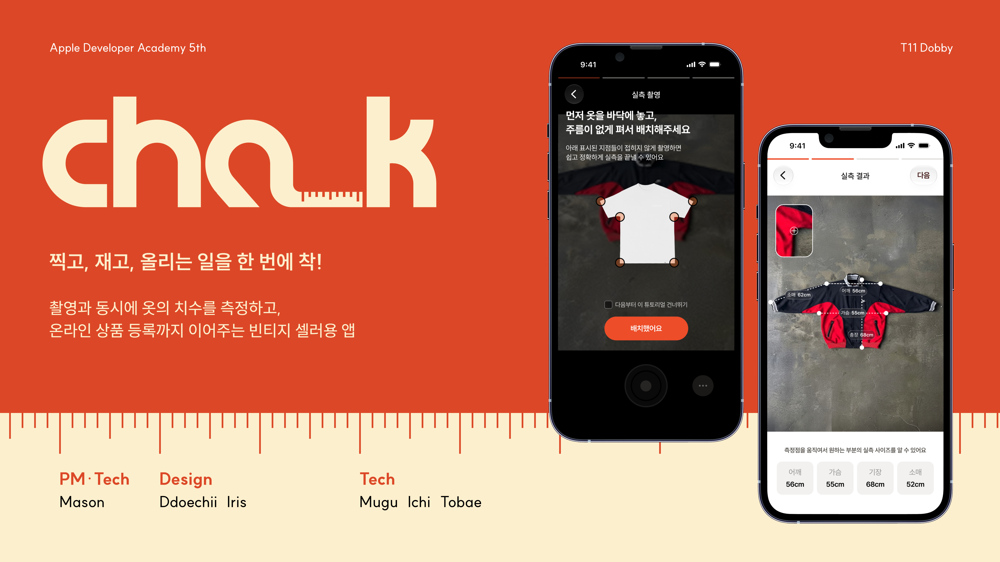
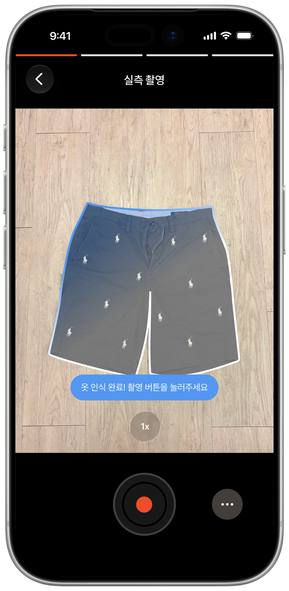
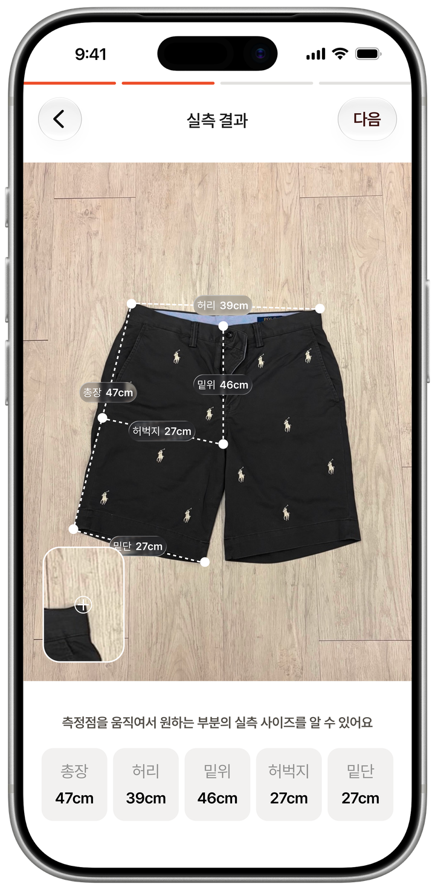
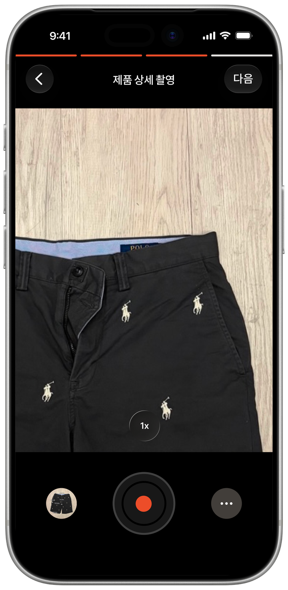
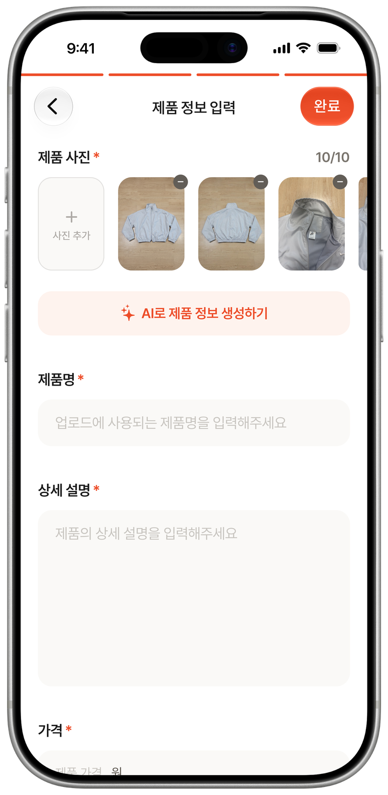
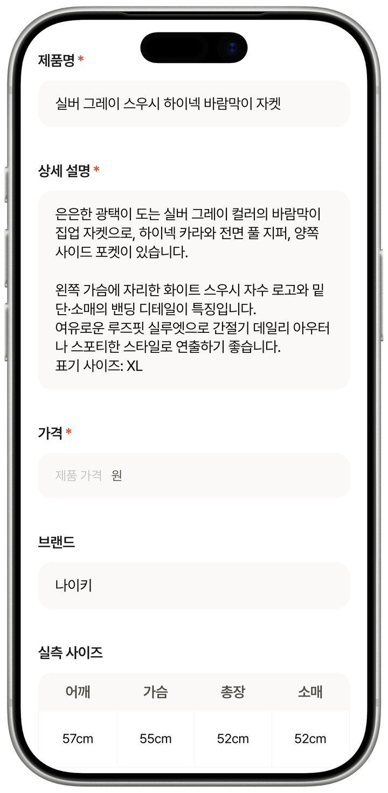
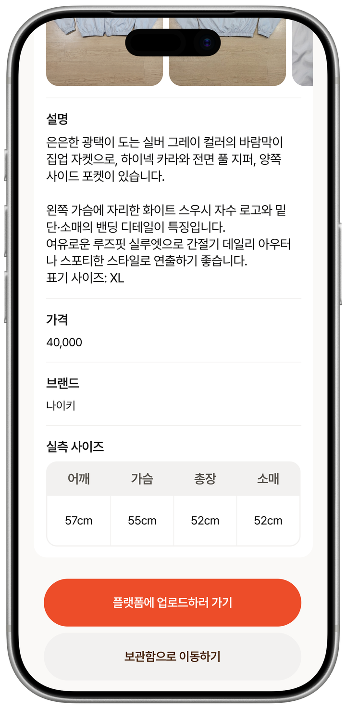
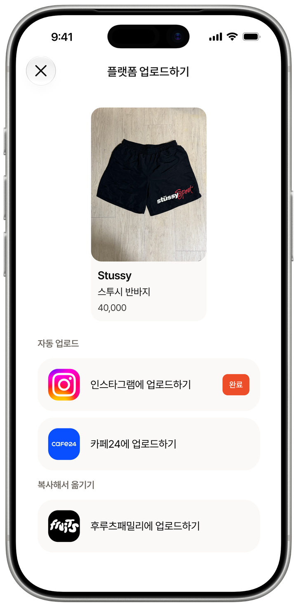
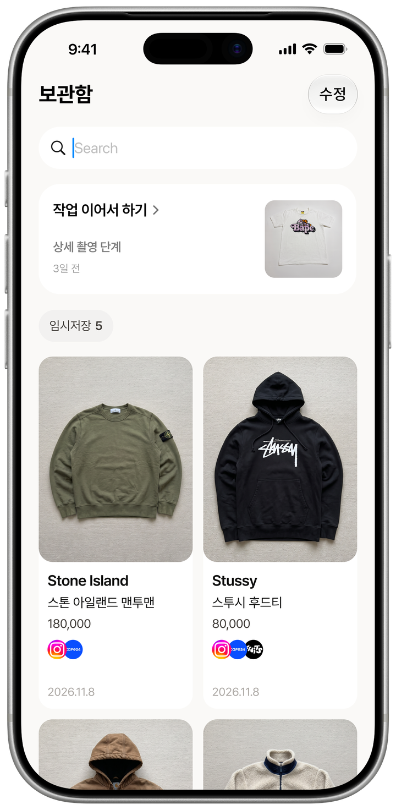
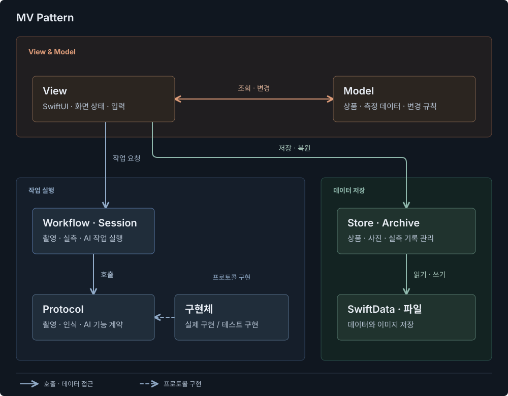

<h1>
  chak(착)&nbsp;
  &nbsp;
  
  
</h1>

<!-- Apple 공식 다운로드 배지 원본: https://developer.apple.com/assets/elements/badges/download-on-the-app-store.svg -->
<!-- iOS 지원 버전과 앱 버전 배지는 App Store 공개 배포 버전 기준 -->

### 빈티지 의류의 촬영부터 판매 준비까지

착은 빈티지숍 운영자를 위한 iOS 앱입니다. 
한 벌의 사진과 실측, 상품 정보를 정리하고 판매 채널로 전달하는 과정을 돕습니다.

---

## ✨ 주요 기능

### 📸 촬영부터 실측까지

옷을 촬영해 실측 결과를 확인하고 측정점을 조정합니다. 제품의 디테일까지 추가로 촬영할 수 있습니다.

<table align="center">
  <tr>
    <td align="center"></td>
    <td align="center"></td>
    <td align="center"></td>
  </tr>
  <tr>
    <td align="center">실측 촬영</td>
    <td align="center">실측 결과</td>
    <td align="center">제품 상세 촬영</td>
  </tr>
</table>

---

### ✨ AI로 상품 정보 완성하기

사진을 바탕으로 AI가 제품명·브랜드·설명 초안을 생성합니다. 생성된 정보를 확인·수정하고, 가격 등 추가 정보를 직접 입력해 상품 정보를 완성합니다.

<table align="center">
  <tr>
    <td align="center"></td>
    <td align="center"></td>
    <td align="center"></td>
  </tr>
  <tr>
    <td align="center">AI 정보 생성</td>
    <td align="center">정보 확인·입력</td>
    <td align="center">상품 정보 완성</td>
  </tr>
</table>

---

### 📦 업로드하고, 보관하고

완성한 상품을 판매 채널로 전달하고 보관함에서 관리합니다. 진행 중인 작업도 저장한 단계부터 이어갈 수 있습니다.

<table align="center">
  <tr>
    <td align="center"></td>
    <td align="center"></td>
  </tr>
  <tr>
    <td align="center">플랫폼 업로드</td>
    <td align="center">보관함</td>
  </tr>
</table>

---

## 🏗 Architecture

착은 **MV(Model–View) 패턴을 기반으로 화면과 데이터를 분리**하고, 촬영·실측·AI 작업과 저장 책임을 별도로 구성했습니다.

| 설계 방식 | 주요 책임 |
|---|---|
| **MV 패턴** | View: 화면·입력 Model: 상품·측정 데이터와 변경 규칙 |
| **작업 실행 분리** | Workflow·Session: 촬영·실측·AI 작업의 실행과 취소 |
| **의존성 주입** | Protocol: 촬영·인식·AI 기능의 계약 구현체: 실제 기능 또는 테스트용 구현 |
| **저장 분리** | Store·Archive: 상품·사진·실측 기록의 저장과 복원 |

---

## 🛠 Tech Stack

### Core Frameworks

### Camera & Photos

### Vision & Measurement

### Concurrency & Networking

### Interaction & Animation

### Backend

### Environment

Xcode와 Swift 컴파일러 버전은 현재 로컬 개발 환경 기준입니다.

### Communication & Design

---

## 👥 Team

<table width="100%">
  <tr>
    <td width="320" align="center"></td>
    <td width="320" align="center"></td>
    <td width="320" align="center"></td>
  </tr>
  <tr>
    <th align="center"><a href="https://github.com/decl5th">이민혁</a></th>
    <th align="center"><a href="https://github.com/qoqoqle">윤현주</a></th>
    <th align="center"><a href="https://github.com/takechaens">박채은</a></th>
  </tr>
  <tr>
    <td align="center">Mason&nbsp;·&nbsp;메&#8288;이&#8288;슨</td>
    <td align="center">Ddoechii&nbsp;·&nbsp;또&#8288;치</td>
    <td align="center">Iris&nbsp;·&nbsp;아&#8288;이&#8288;리&#8288;스</td>
  </tr>
  <tr>
    <td align="center">🎯&nbsp;PM&nbsp;·&nbsp;💻&nbsp;Developer</td>
    <td align="center">🎨&nbsp;Product&nbsp;Designer</td>
    <td align="center">🎨&nbsp;Product&nbsp;Designer</td>
  </tr>
</table>

<table width="100%">
  <tr>
    <td width="320" align="center"></td>
    <td width="320" align="center"></td>
    <td width="320" align="center"></td>
  </tr>
  <tr>
    <th align="center"><a href="https://github.com/tobae-time">박지원</a></th>
    <th align="center"><a href="https://github.com/moogoochung">정무구</a></th>
    <th align="center"><a href="https://github.com/hana5111">오하나</a></th>
  </tr>
  <tr>
    <td align="center">Tobae&nbsp;·&nbsp;토&#8288;바&#8288;에</td>
    <td align="center">Mugu&nbsp;·&nbsp;무&#8288;구</td>
    <td align="center">Ichi&nbsp;·&nbsp;이&#8288;치</td>
  </tr>
  <tr>
    <td align="center">💻&nbsp;Developer</td>
    <td align="center">💻&nbsp;Developer</td>
    <td align="center">💻&nbsp;Developer</td>
  </tr>
</table>

---

## 🔗 Links

[프로젝트 소개](https://developeracademy-postech.github.io/2026-C6-M11-Dobby-Web/) · [고객 지원](https://app.notion.com/p/chak-407b4b9ddf0c802f9886dfa23ab61269?source=copy_link) · [개인정보 처리방침](https://app.notion.com/p/chak-404b4b9ddf0c806aa4f2ce677c724b0b?source=copy_link)

<!-- 시연 영상 URL이 준비되면 링크 추가 -->

<!--
게시 전 확인
- 기능별 화면 이미지 추가
- 공개 빌드의 기능 범위와 기술 스택 대조
- 시연 영상 URL 연결
-->
